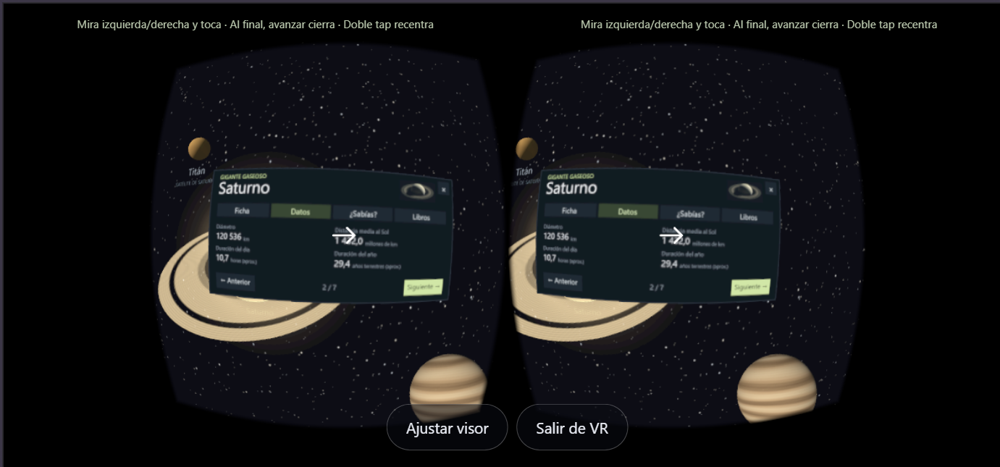
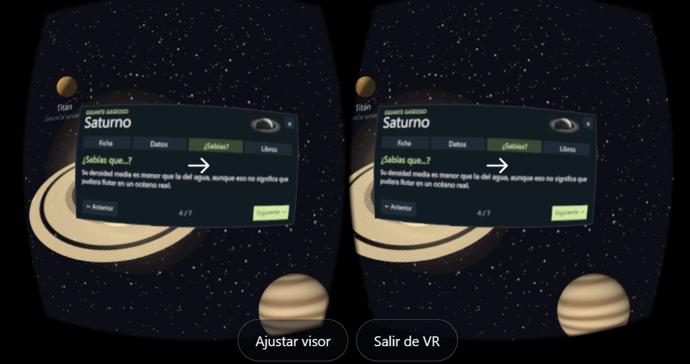
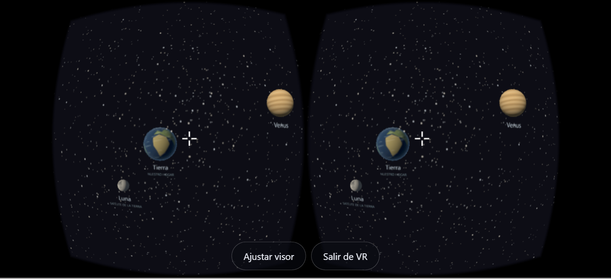
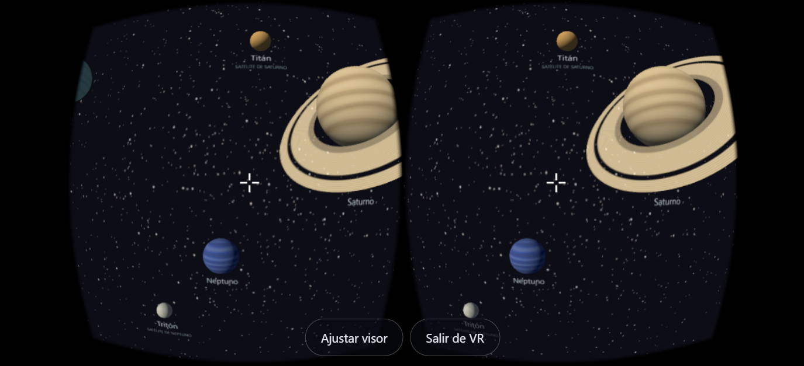
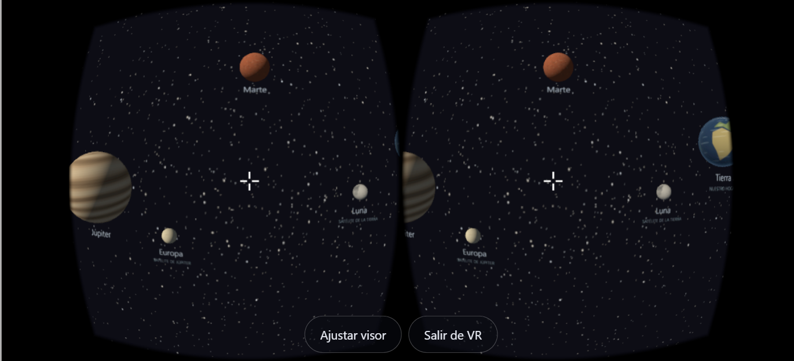

# Análisis de nitidez integral de la escena VR de Metseri

Fecha: 17 de noviembre de 2026. Base revisada: commit `fb6c5e0`. El diagnóstico original y las capturas aportadas se conservan a continuación. La sección «Implementación y verificación» registra el cambio aplicado por solicitud de Sophia, sus mediciones y la aceptación física pendiente. La calidad se automatiza desde el ajuste de pulgadas para toda la escena.

## Resultado del análisis

La pérdida de legibilidad tiene varias causas acumuladas: letras pequeñas después de la proyección, resolución limitada por ojo y sucesivos muestreos de una imagen de texto. El control de pulgadas calibra la geometría del visor, pero no incrementa la resolución de la ficha. La solución debe mejorar el tamaño final de lectura y la cadena de renderizado de fichas, nombres, cuerpos y cielo, manteniendo un presupuesto gráfico medible. El visitante solo indicará la diagonal; el programa calculará automáticamente el resto.

La optimización anterior limitó la densidad a 1.25 en VR para reducir carga. Esa decisión conserva su utilidad para la fluidez, pero necesita complementarse con una estrategia integral de lectura e identificación. Aumentar solo la ficha o solo las imágenes de los planetas no cubre el objetivo actual.

## Evidencia y alcance

Sophia aclaró que las capturas corresponden a pruebas de distintos ajustes de pulgadas en una misma computadora. También reportó la misma dificultad en un iPhone identificado por ella como 18 Pro Max de 6.9 pulgadas, un Motorola de aproximadamente 7 pulgadas y otro teléfono de aproximadamente 7 pulgadas. Los modelos exactos de los dos últimos, sus resoluciones, los navegadores y el modelo físico del visor no quedaron identificados. No se atribuyen características técnicas adicionales a esos equipos.

Figura 1. Captura de computadora aportada por Sophia para el ajuste de 8 pulgadas. Las etiquetas y unidades de Datos pierden definición, mientras los botones HTML y el puntero se ven más definidos.

Figura 2. Captura de computadora aportada para el ajuste de 6.9 pulgadas. El texto de curiosidades también presenta poca definición. Las capturas tienen distintas dimensiones y secciones, por lo que no constituyen por sí solas una comparación controlada entre diagonales.

Figura 3. Evidencia nueva del antes: nombres y relaciones de Tierra, Venus y Luna pequeños y suaves, con un cielo de puntos y cuerpos de diferente tamaño. El puntero se ve más definido que las etiquetas.

Figura 4. Evidencia nueva del antes: bordes y bandas de Saturno y Neptuno con detalle limitado y etiquetas pequeñas. La etiqueta inferior de Tritón coincide con los botones de VR. El corte de Saturno cerca del límite del campo no se confunde con falta de resolución.

Figura 5. Evidencia nueva del antes: contraste y tamaño de nombres, relaciones de satélites, superficies y estrellas deben evaluarse juntos. Para juzgar las formas se añadirá también una pose centrada de cada cuerpo.

Los tres archivos nuevos miden respectivamente 1377 × 630, 1375 × 627 y 1371 × 624 píxeles. No se informó su diagonal individual, DPR, viewport efectivo ni pose numérica; se conservan como referencias visuales originales del antes, sin asignarles una calibración supuesta.

Se revisaron la calibración, el Canvas de la ficha, la composición de páginas, etiquetas VR, superficies procedurales, geometrías, cielo y renderizado por ojo. Se calcularon tamaños proyectados con las fórmulas actuales. No se realizaron nuevas mediciones físicas de FPS, consumo, enfoque de lentes o lectura en los teléfonos mencionados.

## Cómo se produce la imagen

La cadena actual es: contenido de la API → texto dibujado en Canvas 2D → `CanvasTexture` sobre un plano → textura de cada ojo → shader de corrección óptica → pantalla. La textura intermedia del ojo se reutiliza entre ambos ojos. Los botones inferiores son HTML y el puntero se dibuja en la pasada final del shader; no recorren la misma cadena que las letras de la ficha.

En `fichaCuerpoVr.js` el Canvas se limita a 900 píxeles de ancho y no distingue coordenadas lógicas de densidad de rasterización. En `contenidoFicha.js`, el cuerpo de texto llega como máximo a 24 píxeles de esa textura; las unidades llegan a 16. Esos números son tamaños en el Canvas, no el tamaño que termina viendo el usuario.

En `rendimientoEscena.js` VR aplica densidad máxima 1.25 y presupuesto de 1 500 000 píxeles. `efectoVisor.js` utiliza esa misma densidad para la textura por ojo, con MSAA de dos muestras, y después aplica la deformación óptica. El antialiasing ya existe: activarlo de nuevo no recuperaría detalles de letras que ocupan muy pocos píxeles. La distinción entre tamaño CSS y resolución interna está documentada en [Three.js Responsive Design](https://threejs.org/manual/pages/responsive.html).

### Etiquetas, cuerpos y cielo

En `etiquetasVisor.js` los nombres y las relaciones se dibujan en texturas de 512 × 128, con fuentes de 52 y 28 px y sprites escalados según distancia. No existe una compensación de tamaño proyectado en función de la diagonal. La cifra de fuente de origen tampoco garantiza que un nombre sea legible después de pasar por las lentes.

En `planetas.js` las superficies se generan a 1024 × 512 y los anillos a 1024 × 1024. La esfera compartida tiene 48 × 32 segmentos y los anillos 160 segmentos angulares. Esto no demuestra que la geometría sea insuficiente: primero se revisan la resolución por ojo, el diámetro visible y el muestreo de superficie antes de añadir polígonos o texturas mayores.

El cielo de `campoEstelar.js` tiene 6000 puntos estables en tres grupos y una textura radial de 64 × 64. Sus halos suaves forman parte del estilo; se busca evitar desenfoque adicional, manchas y parpadeo, no convertir todas las estrellas en puntos duros ni aumentar su cantidad para aparentar detalle.

Todos estos recursos atraviesan la salida por ojo y la corrección óptica. Por eso una mejora limitada al Canvas de la ficha dejaría sin resolver buena parte de las nuevas evidencias.

## Qué hace el ajuste de pulgadas en la versión actual

`perfilVisor.js` convierte la diagonal declarada y las dimensiones de `screen` a milímetros, y calcula los centros ópticos y el campo de cada ojo usando un perfil HOMIDO GRAB fijo. La escala de la ficha se calcula por otra vía a partir del viewport, sin compensar explícitamente su legibilidad cuando cambia la diagonal.

En la versión actual analizada, con el mismo viewport y manteniendo `screen` constante, cambiar 6.9 por 8 pulgadas aumenta los milímetros asignados a cada píxel. Para el mismo tamaño virtual de letra, el tamaño proyectado en píxeles CSS se reduce aproximadamente un 13.75 %. La cantidad de píxeles de la textura de texto y de cada ojo permanece igual. La propuesta compensará este comportamiento automáticamente; no se usará una diagonal falsa como control de zoom.

El fabricante publica para el HOMIDO GRAB un rango de compatibilidad de 4.5 a 6 pulgadas y un campo anunciado de 100°. Por tanto, aceptar 7 u 8 en el formulario no demuestra compatibilidad física u óptica de ese modelo con esos dispositivos. Esto no demuestra que el visor usado por Sophia sea incompatible: su modelo no fue identificado. Véase [información oficial del HOMIDO GRAB](https://homido.com/homido-grab/). Esta diferencia se registra como límite técnico de la verificación física; no requiere añadir controles al formulario ni demuestra que el dispositivo concreto de Sophia sea incompatible.

## Estimaciones controladas del modelo actual

Supuestos: `screen` igual al viewport, densidad del dispositivo 3, ficha centrada frente a la mirada y perfil óptico existente. Se reproduce la escala del plano y se invierte numéricamente el polinomio radial para proyectar una altura de fuente en el cuerpo de lectura, cerca de su centro. Los valores son alturas em aproximadas en píxeles CSS, no la altura de tinta de cada carácter, una medición ocular ni una lectura directa de las capturas.

| Viewport CSS | Ajuste | Canvas de ficha | Textura por ojo | Cuerpo em proyectado | Unidades em proyectadas |
|---|---:|---:|---:|---:|---:|
| 1381 × 645 | 6.9″ | 900 × 550 | 864 × 807 | 9.5 px | 6.4 px |
| 1381 × 645 | 8″ | 900 × 550 | 864 × 807 | 8.2 px | 5.5 px |
| 1045 × 552 | 6.9″ | 900 × 486 | 654 × 690 | 7.8 px | 5.2 px |
| 1045 × 552 | 8″ | 900 × 486 | 654 × 690 | 6.7 px | 4.5 px |
| 844 × 390 | 6.9″ | 760 × 440 | 528 × 488 | 8.2 px | 5.5 px |
| 844 × 390 | 8″ | 760 × 440 | 528 × 488 | 7.1 px | 4.7 px |

Los archivos aportados miden 1381 × 645 y 1045 × 552 píxeles. Las dos primeras resoluciones del modelo usan esas dimensiones como viewports hipotéticos; no demuestran el viewport, screen ni DPR efectivos con que se capturaron. La tercera es una ventana móvil emulada de referencia. Ninguna representa una resolución física acreditada de los teléfonos. El ajuste de 7 pulgadas debe formar parte de la matriz de aceptación junto con 6.9 y 8.

## Hallazgos priorizados

| Prioridad | Hallazgo | Evidencia | Acción propuesta |
|---|---|---|---|
| P1 | Letras pequeñas tras la proyección | Cuerpo inferior a 10 px em y unidades inferiores a 6 px en parte del modelo | Adaptar automáticamente fuentes y escala, con continuaciones |
| P1 | Nombres poco legibles fuera de las fichas | Nuevas capturas y texturas de etiquetas de tamaño fijo | Compensar tamaño proyectado y rasterización de nombres y relaciones |
| P1 | Calidad por ojo sin respuesta al aumento de pulgadas | Límite 1.25 común a toda la escena, independiente de la diagonal | Derivar una configuración integral automática, acotada por dispositivo |
| P2 | Cuerpos con detalle aparente suave | Superficies, anillos y contornos en las tres evidencias nuevas | Revisar salida y muestreo antes de aumentar recursos procedurales |
| P2 | Etiquetas bajo controles | Nombre/relación de Tritón junto a la barra inferior | Reservar área útil y reposicionar etiquetas sin mover cuerpos |
| P2 | Estrellas y filtros requieren estabilidad temporal | El fondo pasa por el mismo muestreo del ojo | Revisar puntos y filtrado por recurso, preservando distribución y brillo |

Los filtros son una contribución potencial que requiere comparación A/B; no se presentan como causa única demostrada. La flecha puede tapar texto, pero no explica el desenfoque general y sus gestos o figuras no se cambian en esta intervención.

## Propuesta revisada de intervención

1. **Calcular la calidad desde las pulgadas.** Mantener el formulario existente con diagonal, Guardar y Cancelar. Al guardar o cambiar el área visible, derivar automáticamente resolución por ojo, densidad de rasterización y tamaños de texto de la diagonal, viewport, screen, DPR y capacidad gráfica. No se añaden preferencias de calidad ni de tamaño.
2. **Compensar al aumentar la diagonal.** El objetivo de resolución por ojo no debe disminuir al pasar 6.9 → 7 → 8 con el mismo equipo. Compensar también fuentes y escala de lectura para que la calibración no vuelva diminuta la información. Si se alcanza un límite físico, registrar esa saturación y conservar lectura mediante composición, sin pedir al visitante otra elección.
3. **Mejorar fichas y nombres.** Separar coordenadas lógicas de backing store y evaluar rasterización inicial 2× con límites GPU. Conservar identidad, contenido y zonas de acción. Proponer como criterio de proyecto em final de al menos 16 px CSS para párrafos de ficha, 14 para sus etiquetas/unidades y nombres del cielo, y 12 para relaciones de satélites en la matriz de referencia. Si una ficha no cabe, usar continuaciones con sus datos íntegros.
4. **Conservar etiquetas visibles.** Revisar parejas completamente visibles y reservar la zona inferior ocupada por botones, desplazando la etiqueta encima del cuerpo cuando no quepa abajo. No mover planetas para colocar un nombre ni dibujar etiquetas sobre la ficha.
5. **Mejorar las formas y superficies.** La resolución automática debe beneficiar también a Tierra, bandas de gigantes, anillos y satélites. Medir cuántos píxeles ocupa cada cuerpo y si la textura de origen limita el detalle; aumentar resolución procedural solo donde la comparación lo justifique, conservando estilo, semilla, posiciones y radios relativos.
6. **Cuidar el cielo y los filtros.** Conservar las 6000 posiciones y el brillo relativo de estrellas y revisar su tamaño efectivo para evitar cuadrados, manchas o parpadeo. Comparar filtrado de texto, superficies y anillos de forma independiente. No usar NearestFilter o un enfoque global como sustituto de muestreo suficiente.

El [diseño](design.md) propone una curva inicial automática de densidad desde 1.5, compensada por diagonal, con máximo 1.75 y presupuesto total de dos megapíxeles de salida, siempre limitada por DPR y GPU. Son valores iniciales a contrastar con fluidez física antes de aceptar el cambio. Pasar de 1.25 a 1.5 ya puede incrementar el trabajo de píxeles un 44 %; no se presenta más resolución como un cambio sin costo.

Una textura lógica de ficha de 900 × 550 rasterizada a 2× utiliza 1800 × 1100 y aproximadamente 7.55 MiB de color RGBA frente a 1.89 MiB, antes de mipmaps y otras copias. Las etiquetas se comparten entre ojos y no se regeneran en cada movimiento. Las superficies se evalúan por tamaño visible para evitar promover innecesariamente todos los cuerpos.

La separación entre tamaño y resolución y el filtrado de etiquetas se fundamenta en [Canvas Textures de Three.js](https://threejs.org/manual/pages/canvas-textures.html). Las decisiones de filtros y recreación de texturas siguen las restricciones documentadas en [Texture](https://threejs.org/docs/pages/Texture.html); las muestras MSAA existentes se revisan como tales, no como resolución de caracteres, según [RenderTarget](https://threejs.org/docs/pages/RenderTarget.html).

Se conserva el enfoque actual de Three.js y Canvas; no se añade un motor, WebXR ni una biblioteca de texto en esta etapa. La ficha normal, el contrato bibliográfico y los gestos actuales permanecen fuera de la revisión visual VR.

## Aceptación y evidencia del después

- Mantener estas cinco capturas como antes. Para un después comparable, registrar la pose, diagonal, viewport, screen, DPR, fuentes y resoluciones y no favorecer una versión mediante reescalados. Cuando falten los parámetros originales, distinguir referencia visual de experimento controlado.
- Matriz principal: diagonales 6.9, 7 y 8; viewports 844 × 390, 1045 × 552 y 1381 × 645; DPR 1, 2 y 3. Agregar reproducción de las tres nuevas áreas de captura y comprobar salida en vertical.
- Leer nombres y relaciones sin apuntar ni seleccionar. Revisar especialmente Tritón/Neptuno y Titán/Saturno para evitar solapamientos con barra, pareja y ficha.
- Comprobar las formas y rasgos de los doce cuerpos en poses centradas, además de las vistas aportadas. No clasificar como desenfoque el recorte de un cuerpo que sale del campo visual.
- Recorrer cuatro secciones por cuerpo con libros y textos largos sin pérdida de cifras, unidades o notas. Verificar ambos ojos y la lectura accesible, cierre, pestañas, mirada, tap y doble tap.
- Verificar estrellas estables al mover la mirada y cambiar pulgadas, con las mismas posiciones, sin artefactos nuevos ni regeneración.
- Comparar 60 segundos de movimiento equivalente en cada teléfono disponible. La presentación automática debe mantener el percentil 95 del intervalo de fotograma dentro de un 10 % de degradación respecto de su base, registrando cuadros dibujados y tiempos GPU cuando sea posible. FPS en reposo no acreditan fluidez sostenida.
- Si la capacidad impide alcanzar conjuntamente lectura y fluidez, documentar la limitación y mantener abierta la aceptación. No introducir una elección manual como solución al conflicto.
- Registrar el resultado de Sophia al leer información, nombres y relaciones y reconocer cuerpos en los teléfonos. Hasta repetirlo, la aceptación física permanece pendiente.

La igualdad de código y ausencia de errores del commit anterior acreditan integridad funcional, no nitidez óptica. La meta de esta revisión es una experiencia de lectura e identificación fácil en toda la escena VR, aplicada automáticamente a partir de la diagonal.

## Implementación y verificación — 17 de noviembre de 2026

El cambio está implementado localmente. No se realizó commit, push, sincronización ni archivo del cambio OpenSpec. La aceptación en teléfonos y con visor físico sigue pendiente; las capturas de Chrome no la sustituyen.

### Cambios aplicados

- Una política común calcula densidad desde pulgadas, viewport, screen, DPR y límites GPU. Usa `min(DPR, 1.75, 1.5 × max(1, pulgadas / 6.9), límite de dos megapíxeles, límite GPU)`. Al guardar pulgadas o redimensionar se actualizan ambos ojos, ficha y etiquetas. Las entradas iguales reutilizan la configuración y recursos. Se conserva exclusivamente el ajuste de diagonal y su almacenamiento existente.
- La ficha utiliza un diseño lógico de 900 × 800 y una textura de 1800 × 1600, limitada a 2048 por lado y cuatro megapíxeles. El aumento de resolución no cambia acciones UV ni páginas. La escala y el desplazamiento dejan visibles el encabezado, las pestañas, los controles y la barra inferior. El encabezado mantiene nombre, clasificación, imagen y X, sin franja de subtítulo.
- Las fuentes se calculan con la inversa de la distorsión de lentes en ambos ojos. Se mide el em completo, incluyendo los extremos del área de lectura. Se conservan los objetivos de 16 px CSS para párrafos y 14 para etiquetas y unidades. Los textos largos continúan en páginas adicionales; Datos mantiene dos columnas y filas completas. Cuerpo, sección y continuación válida se conservan al ajustar la presentación; una composición sustituida invalida los taps capturados.
- Los nombres y relaciones usan Canvas lógico de 512 × 160 y textura de 1024 × 320. Se dimensionan para 14/12 px CSS em sin selección. La colocación considera el texto real, prioriza las relaciones de satélites y evita coincidencias entre etiquetas, barra inferior y ficha. Hay pruebas específicas de Titán/Saturno y Tritón/Neptuno, incluyendo pequeños cambios de orientación.
- Texto: filtrado lineal sin mipmaps; superficies y estrellas conservan sus filtros. Se compararon las dos variantes de texto en la misma ficha y 120 pasos de movimiento por variante. La variante lineal conserva mejor los trazos pequeños en las capturas; no se aplica NearestFilter ni enfoque global. La evaluación temporal y óptica definitiva corresponde a la prueba física pendiente.
- Anillos: anisotropía automática hasta 4×, limitada por hardware, conservando mipmaps, transparencia, geometría y textura. Se restaura 1× al salir de VR y no se vuelve a subir la textura con entradas iguales.
- El cielo y los cuerpos aprovechan la nueva resolución por ojo. Se mantienen las 6000 estrellas, semilla, posiciones y brillo, las geometrías y radios, y las superficies procedurales de 1024 × 512. Las mediciones no justifican aumentar estas fuentes: los diámetros centrados van de unos 22 a 170 píxeles físicos en los casos de referencia; el anillo mayor queda por debajo de unos 400 frente a su fuente de 1024. La fuente radial de estrellas de 64 × 64 también supera el tamaño de sus puntos. Aumentarlas no recuperaría detalle adicional en esta salida y sí consumiría memoria.

### Comparación controlada

Se ejecutó una copia inmutable de `fb6c5e024b3fd031098ad552b28341f59c84aa0f` y la versión local con la misma API real, viewport/screen 1381 × 645, DPR 3, diagonal 8 y poses registradas. Las imágenes originales del usuario son referencias del antes; sus parámetros desconocidos no se han inventado. Las tres poses de cielo reproducidas son aproximaciones documentadas de aquellas referencias.

Mediciones sobre el Canvas realmente dibujado y sus matrices de escena/cámara, después de lentes. Se muestra el menor valor de los dos ojos en Saturno:

| Medida | Base controlada | Después |
| --- | ---: | ---: |
| Resolución por ojo | 864 × 807 | 1035 × 967 |
| Textura de ficha | 900 × 550 | 1800 × 1600 |
| Párrafo, em CSS | 7.7 px | 16.5 px |
| Etiqueta «Diámetro», em CSS | 5.8 px | 14.3 px |
| Cifra «120 536», em CSS | 9.0 px | 19.3 px |
| Unidad «km», em CSS | 5.3 px | 15.9 px |

En 844 × 390, DPR 3 y 8 pulgadas, la salida llega a 734 × 679 por ojo; el párrafo medido alcanza 17.1 px em y «Diámetro», 14.6. En 1381 × 645 la densidad se estabiliza en aproximadamente 1.498 al alcanzar el presupuesto. Eso explica por qué aumentar pulgadas no obliga a elevar indefinidamente la resolución: la lectura se compensa también con tipografía y composición.

La ficha RGBA utiliza aproximadamente 11 MiB sin mipmaps; cada etiqueta, 1.25 MiB. Hay una textura de ficha y doce etiquetas, compartidas entre ojos, no una copia por ojo. Las etiquetas se crean al entrar en VR; todos estos recursos se liberan al destruir la escena. El mayor consumo y la mayor cantidad de píxeles necesitan confirmación térmica y de fluidez en teléfonos reales.

### Evidencia visual

Ficha de Saturno en Datos, antes controlado:

La misma ficha después:

Vista móvil horizontal de la ficha, después:

Sectores equivalentes a las tres nuevas referencias aportadas, después:

Las versiones de Ficha y ¿Sabías? de Saturno, los tres cielos de la base y las cuatro secciones de los doce cuerpos se conservan en [base](../../../evidencias/nitidezVr/base) y [actual](../../../evidencias/nitidezVr/actual). [Móvil](../../../evidencias/nitidezVr/movil) añade los doce cuerpos centrados y sus cuatro secciones. Los PNG de cada sección muestran el Canvas de origen; los archivos `visor-` y `referencia-` muestran la salida óptica. Un cuerpo parcialmente fuera del campo sigue recortado: no se modifican sus posiciones para disimularlo.

### Verificaciones y estado de aceptación

- **285 pruebas automáticas**, sin fallos: proyección inversa contrastada con el shader, presupuestos, contenido completo, texto proyectado, acciones UV, continuaciones, invalidación de taps, recursos, oclusión, cambios de pulgadas y salida de VR. Incluyen contenido disponible, carga, error y copia descargada.
- **27 combinaciones en Chrome**: 3 viewports × 3 diagonales × 3 DPR. En cada combinación se consultaron los doce cuerpos y sus tres libros reales, se compusieron todas las páginas y se comprobó la geometría de texto, el em proyectado y las cuatro secciones. La UI recorrió las cuatro secciones de cada cuerpo en escritorio y móvil emulado. También se verificaron salida en vertical, entrada con coma decimal y persistencia del único ajuste.
- **Lint, build, `git diff --check` y OpenSpec estricto**, correctos. La compilación conserva el aviso de chunk superior a 500 kB; no se incorporaron dependencias ni cambios de API, CSS/HTML de la ficha normal o catálogo científico.
- **Movimiento en computadora**: se registraron 60 segundos de la misma secuencia de teclado, ambos ojos, viewport 844 × 390 y DPR 3. El p95 de rAF fue 16.8 ms en la base y 16.9 ms en la versión actual (aproximadamente +0.6 %), con 3599 intervalos y 14396 llamadas de dibujo en ambas. La densidad pasa de 1.25 a 1.739. Es una comprobación local emulada: rAF no equivale a tiempo GPU y no acredita sensores, temperatura o visores móviles. Los datos completos están en el registro enlazado abajo.
- **Pendiente**: Sophia debe repetir lectura de párrafos, cifras, unidades, nombres y relaciones, reconocimiento de los cuerpos y 60 segundos de movimiento en los teléfonos disponibles. Registrar modelo exacto, navegador y visor. El p95 físico debe quedar dentro del 10 % de la base del mismo dispositivo; si no cumple, habrá que ajustar la política automática. No se ha acreditado ese resultado ni la aceptación de Sophia.

Registros: [originales y hashes](../../../evidencias/nitidezVr/lineaBase.json), [capturas controladas](../../../evidencias/nitidezVr/actual/capturas.json), [matriz completa](../../../evidencias/nitidezVr/matriz.json), [mediciones de fuentes y cuerpos](../../../evidencias/nitidezVr/mediciones.json), [movimiento y filtros](../../../evidencias/nitidezVr/movimientoEmulado.json). Las capturas y registros no contienen credenciales ni cambios en la base de datos.
